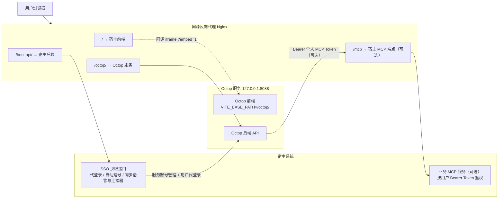
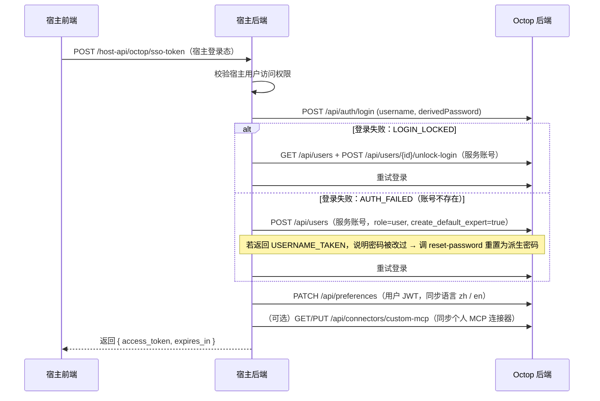

# Octop 嵌入模式改动说明与宿主系统接入指南

本文档面向需要将本 fork（`gujunxiang/Octop`，`coe/main` 分支）嵌入已有业务系统的开发团队。文档内容不绑定特定后端语言或前端框架，可直接作为其他系统接入的实施手册。

---

## 1. Fork 改动清单与升级维护

`coe/main` 基于上游 `TencentCloud/Octop`（当前基线 `v1.0.3b7`），**所有改动均为纯前端（`dashboard/src/`）**，后端与运行时代码零改动。

### 1.1 改动汇总（相对上游 `v1.0.3b7`）

| Commit | 改动内容 | 涉及文件 |
|---|---|---|
| `0f093443` | 支持 `?embed=1`，嵌入模式下隐藏 Octop 自身左侧导航与云协作（cloud）作用域 | `dashboard/src/layouts/MainLayout/index.tsx`<br/>`dashboard/src/pages/Chat/components/ChatNavScopeTabs.tsx` |
| `42ffbc51` | 移除 PWA「新版本已就绪」更新提示（由部署流程统一控制版本） | `dashboard/src/App.tsx` |
| `3ac9ac3e` | 嵌入模式下隐藏专家/团队 Tab 切换与创建专家入口，抽离判定工具 `isEmbedded()` | `dashboard/src/utils/embedMode.ts`（新增）<br/>`dashboard/src/pages/Chat/components/ChatNavScopeTabs.tsx`<br/>`dashboard/src/pages/Chat/components/MinimalAgentSessionNav.tsx`<br/>`dashboard/src/pages/Chat/components/SessionList.tsx` |
| `34e8d1f3` | 嵌入模式下将专家排序按钮移至搜索框旁，优化紧凑布局 | `dashboard/src/pages/Chat/chatThemeOverrides.partial.less`<br/>`dashboard/src/pages/Chat/components/MinimalAgentSessionNav.tsx`<br/>`dashboard/src/pages/Chat/components/SessionList.tsx` |
| （待提交） | 嵌入模式下普通用户只能对话：隐藏连接器/知识库/模型 chip、「+」菜单与快捷指令，固定使用专家预设（见 1.3） | `dashboard/src/hooks/useEmbeddedComposerLock.ts`（新增）<br/>`dashboard/src/pages/Chat/components/ChatInputActionsRow.tsx`<br/>`dashboard/src/pages/Chat/components/ChatInputPreviewBar.tsx`<br/>`dashboard/src/pages/Chat/components/UserMessageComposerTags.tsx`<br/>`dashboard/src/pages/Chat/components/MessageBubble.tsx`<br/>`dashboard/src/pages/Chat/hooks/useChatComposerResources.ts` |

### 1.2 嵌入模式判定机制

`MainLayout` 在页面加载时读取 URL 查询参数 `?embed=1`：

- 命中 `?embed=1` 时，自动写入 `sessionStorage.setItem('octop:embed', '1')`；
- 后续在 iframe 内跳转路由（即使 URL 不再携带 `?embed=1`）时，通过 `isEmbedded()` 读取 `sessionStorage.getItem('octop:embed') === '1'`，持续保持嵌入模式；
- 不带 `?embed=1` 直接独立打开 Octop 时，行为与上游完全一致，不影响管理员直接登录管理后台。

### 1.3 嵌入模式下普通用户只能对话

嵌入模式下，Octop 角色不是 `admin` 的用户（宿主经 SSO 开通的账号都是 `user`）只能对话，判定集中在 `useEmbeddedComposerLock()`：

- 隐藏：输入框上方的连接器、知识库、模型 chip；已发送消息下的同类标签；宽屏下的「+」菜单、角标、平铺在工具栏上的各选择器按钮和 ⚡ 快捷指令；
- 保留：📎 上传、输入框内的 `/` 技能菜单和 `@` 专家菜单；窄屏（紧凑布局）下「+」仍在，但只含「上传」和「润色」，不显示角标；
- 专家预设的连接器、知识库和模型照常随每轮发送，且忽略此前保存的选择、会话里记住的模型和对话模式，始终使用专家默认值（模式未配置时为 `craft`，连接器只在该模式下生效）；`/` 命令切换模式也会被忽略；
- `admin` 用户和独立打开 Octop 时不受影响。

升级上游时请保留这些判定，并运行 `ChatInputActionsRow`、`embeddedComposerChips`、`useChatComposerResources` 三组测试确认。

### 1.4 跟进上游新版本

```bash
git fetch upstream --tags
git switch coe/main
git merge <upstream-tag>            # 例如 v1.0.3b8，如有冲突在此解决
git push origin coe/main
git tag v<upstream-version>-coe.1   # 可选：为发布版本打 tag，便于回滚
git push origin v<upstream-version>-coe.1
```

---

## 2. 总体接入架构

接入的核心前提是**同源部署**：Octop 与宿主系统共用同一个域名，经由反向代理挂载在子路径（推荐 `/octop/`）下。同源后，宿主前端可直接读写 Octop 所需的 `localStorage` / `sessionStorage`，无需改造 Octop 的登录流。



---

## 3. 构建与网关同源部署

### 3.1 子路径构建要求

打包 Octop 前端时必须指定 `VITE_BASE_PATH`，与反向代理前缀一致（含前后斜杠）：

```bash
cd dashboard
VITE_BASE_PATH=/octop/ pnpm run build
```

构建完成后，建议校验产物中是否包含 `octop:embed` 字符串，防止误用上游未带嵌入改动的源码构建。

### 3.2 Nginx 最小配置模板

> **踩坑提示**：即使前端按 `VITE_BASE_PATH=/octop/` 构建，Octop 仍有少量 WebSocket/媒体请求与根路径静态资源不带 `/octop/` 前缀。下面的配置只放行 Octop 实际使用的子路径，避免抢占宿主系统自身的 `/api/` 或 `/assets/`。

```nginx
upstream octop-server {
    server 127.0.0.1:8088;
}

# 仅 WebSocket 请求升级连接，普通 HTTP 与 SSE 保持 close
map $http_upgrade $octop_connection_upgrade {
    default upgrade;
    ''      close;
}

server {
    # 1. Octop 主入口（proxy_pass 末尾斜杠用于剥离 /octop/ 前缀）
    location /octop/ {
        proxy_set_header Host $http_host;
        proxy_set_header X-Real-IP $remote_addr;
        proxy_set_header X-Forwarded-For $proxy_add_x_forwarded_for;
        proxy_set_header X-Forwarded-Proto $scheme;
        proxy_http_version 1.1;
        proxy_set_header Upgrade $http_upgrade;
        proxy_set_header Connection $octop_connection_upgrade;
        proxy_read_timeout 3600s;
        proxy_buffering off;
        proxy_cache off;
        proxy_pass http://octop-server/;
    }

    # 2. Octop 不带 /octop 前缀的 API / WS 子路径（确认与宿主 /api/ 前缀无冲突）
    location ~ ^/api/(agents|workspace|desktop-stream|mobile-stream|mobile|browser-stream|bridge)/ {
        proxy_set_header Host $http_host;
        proxy_set_header X-Real-IP $remote_addr;
        proxy_set_header X-Forwarded-For $proxy_add_x_forwarded_for;
        proxy_set_header X-Forwarded-Proto $scheme;
        proxy_http_version 1.1;
        proxy_set_header Upgrade $http_upgrade;
        proxy_set_header Connection $octop_connection_upgrade;
        proxy_read_timeout 3600s;
        proxy_buffering off;
        proxy_cache off;
        proxy_pass http://octop-server;
    }

    # 3. Octop 根路径静态资源（按需保留）
    location /experts/     { proxy_set_header Host $http_host; proxy_pass http://octop-server; }
    location /monaco/      { proxy_set_header Host $http_host; proxy_pass http://octop-server; }
    location /assets/mbti/ { proxy_set_header Host $http_host; proxy_pass http://octop-server; }
    location ~ ^/(octop-mascot-[^/]+|pwa-\d+\.png|apple-touch-icon\.png)$ {
        proxy_set_header Host $http_host;
        proxy_pass http://octop-server;
    }
}
```

### 3.3 数据目录注意项

首次启动 Octop **之前**务必配置好系统级环境变量 `OCTOP_HOME`（例如 `d:\octop\data` 或 `/var/lib/octop`）。创建 Agent 时，工作区的绝对路径会写入 SQLite/PostgreSQL 数据库，后续迁移 `OCTOP_HOME` 需要同步修正数据库中的路径。

---

## 4. 后端 SSO 接入协议

宿主后端提供一个受自身鉴权保护的换取接口（例如 `POST /host-api/octop/sso-token`），校验当前用户的访问权限后，由后端代为向 Octop 换取**该用户本人的 JWT** 并返回前端。**Octop 管理员服务账号凭据绝不下发到前端。**

### 4.1 账号映射与密码派生

| 项 | 建议规则 | 说明 |
|---|---|---|
| Octop 用户名 | `<sys_prefix>_<hostUserId>` | 固定前缀避免与 Octop 已有账号冲突，且与宿主用户 ID 稳定绑定 |
| Octop 密码 | `Prefix + Base64Url(HMAC-SHA256(hmacKey, username))` | 后端实时复算，不落库；前缀确保包含大小写字母和数字，满足 Octop 密码复杂度策略（≥8 位） |
| 角色 | `user` | 普通用户角色；宿主管理员不自动获得 Octop 管理员权限 |

### 4.2 换取时序与自动恢复



### 4.3 依赖的 Octop REST API 清单

| 阶段 | Method & Path | 鉴权身份 | 关键请求字段 / 说明 |
|---|---|---|---|
| 用户/服务账号登录 | `POST /api/auth/login` | 无 | `{ "username": "...", "password": "..." }` → 返回 `access_token`、`expires_in`、`user`；若返回 `mfa_required: true` 或 `CAPTCHA_REQUIRED`，直接报错不绕过 |
| 查询用户 | `GET /api/users` | 服务账号 | 按 `username` 匹配，获取 `id` 与 `disabled` 状态（若 `disabled: true`，直接拒绝） |
| 创建用户 | `POST /api/users` | 服务账号 | `{ "username", "password", "role": "user", "display_name", "email"?, "create_default_expert": true }`；若返回 `EMAIL_TAKEN`，去掉 `email` 重试 |
| 更新资料 | `PATCH /api/users/{id}` | 服务账号 | `{ "display_name", "email"? }`；资料同步失败只记告警，不阻断登录 |
| 解除登录锁定 | `POST /api/users/{id}/unlock-login` | 服务账号 | 处理错误码 `LOGIN_LOCKED` |
| 重置密码 | `POST /api/users/{id}/reset-password` | 服务账号 | `{ "new_password": derivedPassword }`；用于账号被手动改密后恢复 |
| 同步界面语言 | `PATCH /api/preferences` | 用户 JWT | `{ "locale": "zh" \| "en" }`；失败只记告警，不阻断登录 |

> 服务账号 JWT 可在宿主后端内存缓存，按 `expires_in` 提前 5 分钟过期；遇到 `401` 时强制重新登录并重试一次。

---

## 5. 前端 iframe 嵌入契约

### 5.1 需要操作的 Storage Key

因为与 Octop 同源，宿主前端在拿到后端返回的 `access_token` 后，按以下契约读写浏览器存储：

| Storage | Key | 值 / 动作 | 作用 |
|---|---|---|---|
| `localStorage` | `auth_token` | 写入 `access_token` | Octop 前端读取的登录凭证 |
| `sessionStorage` | `auth_token` | `removeItem` | 清理可能残留的会话级旧 token |
| `localStorage` | `octop:active-agent` | `removeItem` | **防止同一浏览器切换宿主账号时串用上一用户的选中专家** |
| `sessionStorage` | `octop:embed` | 写入 `'1'` | 通知 Octop 进入嵌入模式 |

宿主系统退出登录（或切换账号）时，务必**同步清除上述全部 4 项**。

### 5.2 iframe URL 构造

```ts
// page 为 Octop 内部路由，如 '/chat'、'/experts'，需校验仅允许以 '/' 开头的安全相对路径
function buildOctopFrameUrl(page: string, nonce: number): string {
  const safePage = /^(?!.*(?:\/\/|\\|\.\.))\/[^:]*$/.test(page) ? page : '/chat';
  const sep = safePage.includes('?') ? '&' : '?';
  return `/octop${safePage}${sep}embed=1&sso=${nonce}`;
}
```

- `embed=1`：触发 `MainLayout` 写入 `sessionStorage['octop:embed'] = '1'`；
- `sso=<nonce>`：重新换取 token 时递增时间戳/随机数，强制 iframe 重新加载文档，避免浏览器复用旧缓存页面。

### 5.3 会话失效检测与自动重登

Octop JWT 过期或被吊销时，iframe 内部会跳转到 `/octop/login`（或兜底跳到无前缀的 `/login`）。宿主页面可在 iframe 的 `load` 事件中检查 `iframe.contentWindow.location.pathname`：

```ts
function isOctopSessionLost(pathname: string): boolean {
  if (pathname === 'blank') return false; // 初始 about:blank
  if (!pathname.startsWith('/octop/')) return true;
  const rest = pathname.slice('/octop/'.length);
  return rest === 'login' || rest === 'login/';
}
```

检测到失效后，自动重新调用宿主 SSO 接口换取新 token、更新 Storage 并用新的 `nonce` 刷新 iframe（建议限制连续重试次数，例如最多 1 次，避免死循环）。

---

## 6. 可选进阶：接入业务系统 MCP 工具

如果希望 Octop 中的 Agent 安全调用宿主系统的业务能力，推荐采用**「每用户独立 MCP Token + SSO 自动配置个人连接器」**模式，避免共享 Agent 导致身份冒用或越权：

1. **宿主提供无状态 Streamable HTTP MCP 端点**（例如 `POST /mcp`，Nginx 需关闭 `proxy_buffering`）：
   - 仅认 `Authorization: Bearer <user_mcp_token>`，每次请求实时校验 Token 有效性、用户状态与业务权限；
   - 在请求级临时上下文中执行业务 Service，复用宿主现有的数据权限与审计日志。
2. **SSO 阶段自动维护个人连接器**：
   - 使用**用户本人的 Octop JWT** 调用 `GET /api/connectors/custom-mcp` 读取 `servers`；
   - 合并写入宿主专属连接器条目（如 `my_sys`），再调用 `PUT /api/connectors/custom-mcp` 整体保存（**必须先读后合并**，不要覆盖用户自己配置的其他连接器）：

```json
{
  "servers": {
    "my_sys": {
      "transport": "streamable_http",
      "url": "https://host.example.com/mcp",
      "headers": { "Authorization": "Bearer <user_mcp_token>" },
      "display_name": "Host System",
      "enabled": true,
      "default_open": true,
      "shared": false
    }
  }
}
```

- 关键安全属性：`shared: false`（不共享给他人）、`default_open: true`（每轮对话默认开启）；
- 权限回收：当宿主用户失去 MCP 权限时，SSO 阶段从 `servers` 中移除该条目并吊销自动签发的 Token；
- 并发保护：同一用户多标签页同时打开时，建议按 `userId` 加短时分布式锁，防止并发读改写互相覆盖；
- 容错原则：连接器同步失败仅记录告警日志，不阻断用户正常进入对话页。

---

## 7. 接入自检清单

- [ ] Octop 前端已使用 `VITE_BASE_PATH=/octop/` 构建，且产物包含 `octop:embed`
- [ ] `OCTOP_HOME` 已在首次启动前配置为系统级持久化目录
- [ ] Nginx 已配置 `/octop/`、Octop 根路径静态资源以及不带前缀的 `/api/(agents|workspace|...)/`，且关闭了缓冲
- [ ] 宿主后端已配置 `hmac-key` 与 Octop 服务账号，且服务账号凭据未暴露给前端
- [ ] 宿主前端登录/切换账号/登出时均正确维护 `auth_token`、`octop:active-agent`、`octop:embed`
- [ ] 在浏览器打开宿主页面，确认 Octop 左侧自身导航、专家/团队切换与创建入口已隐藏，对话流式输出正常
- [ ] 同一浏览器切换不同宿主账号登录，确认不会串用上一账号的会话或选中专家
